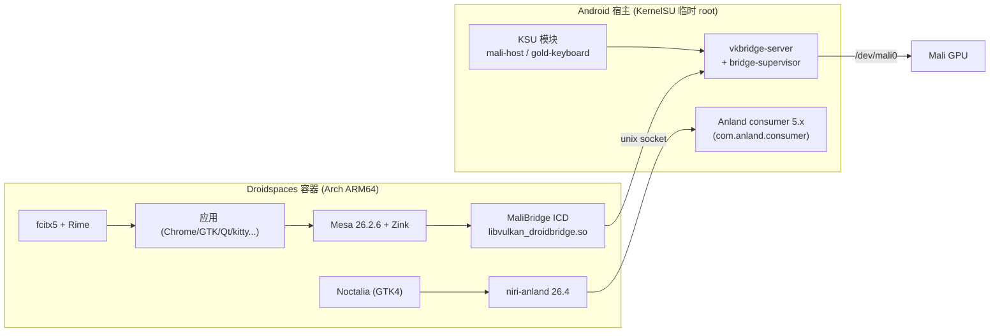

# XRING-O3 Droidspaces / Mali 复刻包

面向 **小米平板 9 Pro Max（M367FC / XRing O3 / Android 17 / Mali-G2-Ultra-NX）** 的 Droidspaces + Arch + niri + Noctalia GPU 桌面：Android 宿主侧资产、KSU 模块、容器侧 Mali 栈与复刻资料。

本仓库解决“补丁到处翻、文件手工拷、每台设备重新调”的问题：**宿主脚本、补丁、KSU 模块、Mali 栈和验证口径集中在这里**；容器 rootfs 镜像由配套仓库 [Droidspaces-Arch-Niri-rootfs-builder](https://github.com/collegeming/Droidspaces-Arch-Niri-rootfs-builder) 构建（见「两个项目如何联动」）。

## 1. 整体架构



- **GPU**：容器内 Mesa/Zink → MaliBridge Vulkan ICD → `/data/local/Droidspaces/Containers/<ctr>/rootfs/opt/mb-sock/mali.sock` → 宿主 `vkbridge-server` → vendor `libGLES_mali.so` / `/dev/mali0`。
- **显示**：容器内 niri-anland 经 Anland daemon socket 输出到 Android 上的 Anland consumer；同一时间只有一个容器上屏。
- **输入**：fcitx5 + Rime 走 Wayland text-input 与 IM 模块；物理键盘可用 Gold 模块做重映射（MIUI 原生快捷键）。

## 2. 仓库内容

| 路径 | 内容 |
| --- | --- |
| `host/` | 宿主脚本：`start-bridge.sh`、`stop-bridge.sh`、`bridge-supervisor.sh`、`anland-link.sh`（含 `-latest` 稳定别名）、`install-host.sh`、`verify-host.sh`、`host.env.example` |
| `ksu-module/mali-host/` | KSU 模块：打包 `vkbridge-server` + host 脚本；默认开机自启（`AUTOSTART=1`） |
| `ksu-module/gold-keyboard/` | Gold Keyboard Remaps 定制：`patches/0001-xiaomi-15d9-00a3-identity.patch`、`config/config.conf`、`build-module.sh` |
| `patches/` | `anland/`（Touch seat）、`smithay/`（AFBC 线性尺寸校验）、`mesa/`（dt-retire/kopper-retire）、`malibridge/`（AFBC 导出元数据、wl-gone shim） |
| `rootfs/device/xring-o3/` | 容器侧设备脚本：安装器、profile、card0/anland、wait-for-bridge、会话环境 |
| `src/` | `libgbm-shim/`（38 符号垫片）、`libdrmfake/`、`mbctl/`（内存预算 CLI）、`mb-tray/`（SNI 托盘）、`zc-run/`（GPU 环境启动器） |
| `scripts/` | `mali-host` / `mali-stack` 打包与校验脚本 |
| `.github/workflows/` | `build-gold-keyboard-ksu.yml`、`build-malibridge.yml`、`build-niri-package.yml` |
| `docs/` | `00-architecture.md`、`01-reproduce.md`、`02-consolidation.md` |
| `dist/` | 本地构建产物（zip 等，git 忽略） |

## 3. 快速开始

### 3.1 宿主侧（Android）

```sh
# 1) 安装 host bundle（含 vkbridge-server 与脚本）到容器 host 目录，
#    或直接安装 mali-host KSU 模块（默认开机自启）
# 2) 为当前容器启动 bridge（SRV 指向该容器 host 目录）
SRV=/data/local/Droidspaces/Containers/archniri16/host sh start-bridge.sh
# 判据：server pid / supervisor pid / socket / control.sock 均打印，预算 4096/2048/2048/60000
# 3) 维护 Anland 别名（每容器一个 + latest 稳定别名）
CTR=archniri16 SRV=.../archniri16/host sh anland-link.sh
# 4) Anland app 的 socket_path 固定填 /data/local/tmp/archniri-latest-display.sock
```

### 3.2 容器侧（由 builder 镜像提供）

```sh
adb push rootfsNN.tar /data/local/tmp/
# 设备上（root）：解压到 /data/local/Droidspaces/Containers/archniriNN/rootfs
droidspaces -C /data/local/tmp/archniriNN.config start
systemctl status desktop-session     # 容器内：niri + Noctalia + fcitx5
```

### 3.3 Gold 键盘（可选）

```sh
# CI 构建：Actions → "build gold keyboard ksu" → 下载 zip
# KernelSU Manager → 模块 → 从本地安装 → 重启
# Anland 需使用补丁版 APK（识别 15d9:00a3 虚拟身份）；输入源选 direct_plus_gold_keyboard
```

## 4. 实现效果（实测）

| 场景 | 结果 | 证据等级 |
| --- | --- | --- |
| 主 niri 合成 | Zink → MaliBridge → Mali GPU 合成 | 设备实测 |
| 主 Noctalia | DMA-BUF 窗口客户端；`vkbridge-wl-shm` memfd 映射为 0 | 设备实测 |
| 容器 Chrome | `create_immed=9`、`wl_shm.create_pool=0`；3 个 WebGL2 页面 60.39/60.06/60.35 FPS，p50 16.6–16.7 ms；GPU 进程存活 69.6 分钟 | 设备实测 |
| 复杂 GL 离屏 | MaliBridge 67 / 19 / 18.5 FPS；llvmpipe 10.9 / 2.7 / 2.3；vtest 60.9 / 17.2 / 16.8 | 设备实测 |
| Xwayland（X11 应用） | 仅 llvmpipe 软件渲染（容器无 renderD 节点），稳定但无 GPU | 设备实测 |
| A 级零拷贝 | **0**：`create_immed>0` 只证明窗口缓冲走 DMA-BUF，合成器侧导入/直接 scanout 未取得证据 | 推断/待验证 |
| 输入法 | 默认中文（rime）；左 Shift 在 Rime 内切中英文；无 Wayland 诊断通知 | 设备实测 |
| MIUI 原生快捷键 | Gold 虚拟键盘伪装 `15d9:00a3`：截图（SYSRQ 99）、音量 115/114、亮度 225/224、静音 113、麦克风 190、勿扰 193、小爱 194 | 设备实测 |

## 5. 两个项目如何联动

| 资产 | 产出方 | 消费方 |
| --- | --- | --- |
| rootfs 镜像（Arch + niri + Noctalia + preferences） | **builder**（`xring-o3-mali` 分支 workflow） | 部署到 Droidspaces 容器 |
| Mali 栈 bundle（Mesa/Zink/ICD/shim/zc-run/mbctl/mb-tray/budget.conf） | **本仓库** releases（`xring-o3-mali-stack-2026.11.08-v2.tar.zst`，sha256 `159ddd87…`） | builder 构建时下载并装入 rootfs |
| niri / niri-anland Arch ARM64 包 | **本仓库** `build-niri-package` workflow（`wayland_package_repository=collegeming/xring-o3-droidspaces-package`） | builder 安装 |
| host bundle（`vkbridge-server` + 宿主脚本） | **本仓库** 构建 / KSU 模块 | 设备宿主安装 |
| 容器内偏好（IM/Noctalia/Rime 等） | **builder** 的 `scripts/preferences/apply-preferences.sh` | rootfs 构建末尾执行 |

构建链：`本仓库打补丁/出包 → builder 用 bundle URL+sha256 构建 rootfs → 设备导入 → 本仓库 host 脚本启动 bridge/别名 → Anland 上屏`。

## 6. 版本与产物（2026-11-10）

| 项 | 值 |
| --- | --- |
| 当前镜像 | rootfs16（builder `xring-o3-mali` @ `3a27756`，sha256 `eecf1172…`） |
| Mali 栈 | `2026.11.08-v2`（sha256 `159ddd87…`） |
| MaliBridge server | v0.5.5.2 |
| niri-anland | 26.4 + Touch seat / Smithay AFBC 补丁 |
| Anland consumer | `5.19-gold-identity-15d9`（collegeming/anland-mali @ `c0aede9`） |
| Gold 模块 | `Gold_Keyboardremaps-1.1.1-yingtian.zip`（24 条映射，59401 B） |
| LKM | lkm4ctr 4.0.5 |
| 容器 | `archniri16`（当前）/ `archniri`（主）/ 13/14/15（迭代） |

## 7. 已知边界

1. **A 级零拷贝为 0**：Chrome 的 `create_immed` 只覆盖窗口缓冲路径；合成器侧导入/scanout 未验证。
2. **Xwayland 仅软件渲染**：容器无 renderD，X11 应用走 llvmpipe。
3. **临时 root**：重启后需重新 root、加载 LKM、启动容器与 bridge（bridge 已接 KSU 模块自启链路）。
4. **功耗不可排名**：设备充电中，传感器数据不能作整机功耗。
5. **120Hz 未达**：Chrome 60 FPS 为当前上限，原因未定位。
6. **Gold 与 Anland 互斥**：Gold 会 `EVIOCGRAB` 物理键盘，Anland 必须使用 `direct_plus_gold_keyboard` 输入源。

## 8. 关联与参考项目

| 项目 | 关系 |
| --- | --- |
| [Goldzxcbug/Droidspaces-rootfs-Desktop-builder](https://github.com/Goldzxcbug/Droidspaces-rootfs-Desktop-builder) | builder 上游模板 |
| [ravindu644/Droidspaces-OSS](https://github.com/ravindu644/Droidspaces-OSS) | Droidspaces 运行时（7.1.0） |
| [ASEbrahim/MaliBridge](https://github.com/ASEbrahim/MaliBridge) | MaliBridge 上游（DroidDeck PR #517）；本仓库含 AFBC 导出元数据补丁 |
| [SuperTurtleDev/anland](https://github.com/SuperTurtleDev/anland) | Anland 上游；[Goldzxcbug/anland](https://github.com/Goldzxcbug/anland) 为 Droidspaces 集成分支 |
| [collegeming/anland-mali](https://github.com/collegeming/anland-mali) | 本设备 Anland fork（Gold 身份识别、Touch/AFBC 补丁） |
| [Goldzxcbug/Gold_Keyboardremaps](https://github.com/Goldzxcbug/Gold_Keyboardremaps) | Gold 键盘上游（本仓库只保存 15d9:00a3 身份补丁与配置） |
| [Shikochin/Droidspaces-LKM](https://github.com/Shikochin/Droidspaces-LKM) / [cyanmint/lkm4ctr](https://github.com/cyanmint/lkm4ctr) | 免刷内核 LKM（PID/IPC namespace） |
| [iDvel/rime-ice](https://github.com/iDvel/rime-ice) | Rime 雾凇拼音 |
| [YaLTeR/niri](https://github.com/YaLTeR/niri) / [Noctalia](https://github.com/noctalia-dev/noctalia) | 合成器与桌面 shell |
| [Dere3046/_patchHarmony](https://github.com/Dere3046/_patchHarmony) / [XGH2333/_patchHarmony](https://github.com/XGH2333/_patchHarmony) | 早期 LKM 补丁参考 |
| [Droid-Deck/DroidDeck](https://github.com/Droid-Deck/DroidDeck) / [taowen/arlinux-rootfs](https://github.com/taowen/arlinux-rootfs) / [taowen/mesa](https://github.com/taowen/mesa) | MaliBridge / 容器 GPU 机制参考 |

## 9. 文档

- [架构与组件清单](docs/00-architecture.md)
- [复刻步骤](docs/01-reproduce.md)
- [整合与复用分析](docs/02-consolidation.md)

同设备的完整整理文档（50 份，按现状/调研/分析/方案/验证/手册/工程化/归档分类）保存在本地 `DroidSpaces/.docs/`。

## 10. 补丁应用顺序

Anland/Smithay：

```sh
git clone https://github.com/SuperTurtleDev/anland.git
git -C anland checkout legacy
git -C anland apply patches/anland/0001-touch-seat.patch
git -C anland apply patches/smithay/0001-afbc-linear-size-check.patch
```

第二个补丁修改的是 Anland 仓库内的 `producers/niri/Arch_v5/smithay.patch`，不是 Smithay 源码本身，构建时由 PKGBUILD 应用到固定版本的 Smithay。

MaliBridge 与 Mesa 补丁是 Python 脚本，按脚本头部记录的固定 commit 运行；具体用法见 `patches/README.md`。

## 11. 许可与致谢

脚本与补丁遵循各自上游许可（MaliBridge、Anland、Gold Keyboard Remaps、Droidspaces 等）。本仓库只保存设备定制补丁与打包/验证脚本，不复制上游源码。
