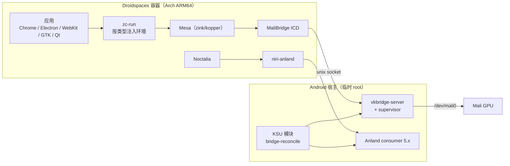

# XRING-O3：小米平板 9 Pro Max 的 Droidspaces GPU 桌面套件

面向 **小米平板 9 Pro Max（M367FC / XRing O3 / Android 17 / Mali-G2-Ultra-NX）** 的 Droidspaces + Arch + niri + Noctalia GPU 桌面：Android 宿主侧资产、KSU 模块、容器侧 Mali 栈、设备补丁与分发脚本。

本仓库负责“容器之外”和“容器与 GPU 之间”的部分：宿主 bridge、Anland 与容器编排、Mali 栈 bundle、应用分类与启动环境、补丁与发布。容器 rootfs 本身由配套仓库 [Droidspaces-Arch-Niri-rootfs-builder](https://github.com/collegeming/Droidspaces-Arch-Niri-rootfs-builder) 构建，两者通过 bundle URL、sha256 和 niri 软件包仓库联动。

## 1. 目标与约束

| 项 | 值 |
| --- | --- |
| 设备 | 小米平板 9 Pro Max，型号 M367FC，平台 XRing O3 |
| 系统 | Android 17；KernelSU + lkm4ctr 提供临时 root |
| GPU | Mali-G2-Ultra-NX MC16；容器内没有 `renderD` 节点 |
| 容器 | Droidspaces 7.1.0，Arch Linux ARM aarch64 |
| 桌面 | niri-anland + Noctalia；Anland 5.x consumer 上屏 |
| 显示 | 3408×2272@120，逻辑缩放 2；同一时间只有一个容器上屏 |

目标：

1. 容器内运行完整的 Arch 桌面（niri + Noctalia + fcitx5/Rime），应用通过 Mali GPU 渲染。
2. 窗口缓冲走 DMA-BUF，避免整窗 CPU 拷贝；合成器侧是否直接 scanout 单独评估。
3. 宿主侧自动完成 bridge、Anland socket、容器启停；bridge 晚到时可自动恢复桌面。
4. Mali 栈、补丁、宿主脚本和验证口径可复现，不依赖手工拷贝。

约束：

- 只有 Mali 可用，不使用 Adreno/KGSL；容器内 Xwayland 没有 GPU 节点，X11 应用走 llvmpipe。
- 容器禁止非特权 user namespace（`unshare -U` 被 seccomp 拒绝），Chromium/Electron 只能走 SUID sandbox helper 或 `--no-sandbox`。
- root 是临时的：设备重启后需要重新获取 root、加载 LKM、启动容器与 bridge。
- Anland 同一时间只支持一个容器上屏；切换容器需要重新指向显示 socket。

## 2. 架构



数据路径分三段：

- **应用 → GPU**：应用通过 EGL/GLES 或 Vulkan 进入 Mesa（zink 把 GL 翻译为 Vulkan）或直接进入 MaliBridge ICD；ICD 把 Vulkan 命令经 Unix socket 发给宿主 `vkbridge-server`，由它调用 Mali 驱动。
- **窗口缓冲**：应用的 Wayland 窗口缓冲由 MaliBridge 的 WSI 导出为 DMA-BUF，经 `zwp_linux_dmabuf_v1.create_immed` 交给合成器；这条链路不经过 `wl_shm` 的整窗 CPU 拷贝。
- **显示**：niri-anland 通过每个容器独立的 Anland broker socket 输出，Android 上的 Anland consumer 负责上屏。

### 2.1 GPU 环境的分配

| 消费方 | Mesa | Vulkan ICD | 额外 |
| --- | --- | --- | --- |
| niri、zc-run 的 WebKit/GTK/Qt 等 | `mesa/kopper` | `droidbridge-format.json` | 会话级环境或 zc-run 注入 |
| zc-run 的 Chromium/Electron | 系统 Mesa（`/usr`） | `droidbridge-format.json` | GBM 垫片与 Chromium flags；避免同时加载两份 `libgallium` |
| Noctalia | `mesa`（dt-retire） | `droidbridge_icd.json` | `noctalia-dt` 额外加载 wl-gone shim |
| 没有包装、保留 `/etc/environment` 的客户端 | 系统 Mesa | `droidbridge_icd.json`（环境变量指定） | 默认 socket `$XDG_RUNTIME_DIR/vkbridge.sock` |
| 环境被清理的客户端（如沙箱子进程） | 系统 Mesa | 系统 ICD `90-droidbridge.json`（hook2） | 默认 socket |

这些组合不是重复配置：Noctalia 的 `wl_surface` 生命周期与 Kopper 的 displaytarget 缓存存在竞态，需要 dt-retire Mesa + wl-gone shim；Chromium 类需要避免同时加载两份 `libgallium`，因此固定系统 Mesa；其余客户端通过 zc-run、`/etc/environment` 或系统 ICD 获得可用组合。

## 3. 改造清单

### 3.1 GPU 栈：让 Mali 在容器内可用

**问题**：容器里没有 `renderD`，厂商只提供 Mali；Droidspaces 的 GPU 直通只解决设备节点，不提供 Vulkan/GL 的桥接和内存预算。

**改造**：

- Mali 栈 bundle：Mesa（kopper 与 dt-retire 两套）、MaliBridge 客户端（format-capacity 与 hook2 两份）、`libgbm` 垫片、`libdrmfake`、`zc-run`、`mbctl`、`mb-tray`、`budget.conf`，统一安装到 `/opt/mali-stack/<version>`，`current` 原子切换。
- 系统级 Vulkan ICD：`/usr/share/vulkan/icd.d/90-droidbridge.json`，作为 `VK_DRIVER_FILES` 缺失时的兜底，让环境被清理的客户端仍能枚举到 Mali。
- 默认 socket 链接：`$XDG_RUNTIME_DIR/vkbridge.sock` 指向容器的 `mali.sock`，浏览器沙箱清理环境后仍能找到 bridge。
- 内存预算：默认 `total_mb=4096`、`pid_mb=2048`、`floor_mb=2048`、`map_limit=60000`，由 `mbctl`/`mb-tray` 读取和调整。
- wl-gone shim：在 `wl_surface` 销毁前通知 ICD 标记 surface，避免 Kopper 的延迟销毁把 present 发到合成器已经遗忘的对象上。shim 在构造函数里把自己从 `LD_PRELOAD` 中剥离，只作用于承载它的进程（Noctalia），不传给子进程。
- Anland/Smithay 补丁：Touch seat 让 niri 注册触摸设备；AFBC 线性尺寸校验避免缓冲尺寸误判。

**适用场景**：所有需要 GPU 的容器应用；Noctalia 的 surface 销毁；Chrome/Electron 的 DMA-BUF 窗口；没有经过桌面包装的命令行客户端。

### 3.2 会话环境：niri、Noctalia 与应用各用一套

**问题**：容器里同时存在发行版 Mesa、两套 Mali 栈 Mesa、两套 ICD；如果所有进程共用一份环境，Chrome 会加载两份 `libgallium`，Noctalia 会因 surface 生命周期崩溃，未包装应用会找不到 ICD。

**改造**：

- `session-gpu-env.sh`：niri 会话启动时读取 `conf/zc-env.conf`，导出 kopper Mesa、format ICD、bridge socket、zink 变量；文件缺失或指向不存在的库时不导出，回退到 `/etc/environment`。
- `/etc/environment`：会话级兜底（Wayland、zink、hook2 ICD、默认 socket、WebKit/Gecko 沙箱开关、IM 模块），保证没有专门包装的进程也有可用环境。
- `noctalia-dt`：在会话环境之上覆盖 dt-retire Mesa、hook2 ICD、wl-gone shim、Noctalia 专用 socket 和日志级别；`niri` 通过 `spawn-at-startup` 启动它。
- `desktop-session`：启动前等待 bridge 两个 socket；清理遗留的 Xwayland、fcitx5、`wl-copy`；再启动 niri。

**适用场景**：会话首次启动；bridge 比容器晚起；Noctalia 崩溃恢复；从终端启动未包装应用。

### 3.3 零拷贝：应用分类与桌面包装

**问题**：同一套环境不能同时满足 Chromium、WebKit、Gecko、Flutter、Qt、GTK4、X11 和终端；桌面启动器又不会走命令行的分类逻辑。

**改造**：

- `zc-run`：按应用类型注入环境。分类器识别 ELF 的类型，也支持 `--class` 强制指定。

| 类型 | 典型应用 | 注入 |
| --- | --- | --- |
| `chromium` | Chrome、Electron、CEF | 系统 Mesa、format ICD、GBM 垫片、Chromium flags；清除 `DISPLAY`；helper 非 4755 且同目录存在 `chrome-sandbox` 时追加 `--no-sandbox` |
| `webkit` | WebKitGTK、Tauri | `libdrmfake`、禁用 WebKit 沙箱、去掉 GBM 垫片 |
| `gecko` | Firefox、Zen | Wayland + WebRender，`MOZ_DRM_DEVICE` |
| `flutter` | Flutter 桌面 | `GDK_BACKEND=wayland`，清除软件渲染变量 |
| `qt` | Qt6 应用 | `QT_QPA_PLATFORM=wayland` |
| `gtk4` | GTK4 应用 | `GDK_BACKEND=wayland`，可选 `GSK_RENDERER` |
| `x11` | X11 应用 | 有 `DISPLAY` 时强制 zink；无 `DISPLAY` 时透传 |
| `sdl` / `terminal` | SDL、终端 | 只带会话环境 |

- `xring-wrap-desktop`：只给需要 per-app 环境的 Web 引擎类（chromium/webkit/gecko/flutter）改写桌面条目，保留原 `Exec` 文本和字段码；对 `#!` 启动脚本跟随 `cd`/`exec` 找到真实二进制再分类；幂等，可重复执行。位于 `/opt` 的应用同时生成 `/usr/local/bin` 垫片，终端直接敲命令也走同一路径。
- 安装期包装：镜像内的 pacman 钩子在每次事务后调用 `xring-wrap-desktop`，新安装的 Chromium/Electron 应用自动获得 `zc-run --class chromium` 的桌面条目。
- 未包装客户端：系统 ICD + 默认 socket 兜底；仍不保证 per-app flags，必要时手动 `zc-run`。

**适用场景**：从 Noctalia 启动器打开新应用；桌面条目是 shell 脚本的应用；终端启动；应用升级后条目被覆盖。

### 3.4 零拷贝矩阵与协议版本

窗口缓冲零拷贝的判据是：`WAYLAND_DEBUG=1` 下 `zwp_linux_dmabuf_v1.create_immed` 出现次数大于 0，且窗口没有 `wl_shm.create_buffer`。`create_immed` 计数是缓冲创建次数，不是帧率或带宽。

| 应用 | create_immed | 窗口 `wl_shm` | 条件与说明 |
| --- | ---: | --- | --- |
| Chrome（单窗口） | 3 | 无 | 镜像 21，3408×2272，scale 2；三缓冲 |
| Chrome（3 个 WebGL2 页面） | 9 | 无 | 3 个页面累计（单窗口为 3）；另有 2 个小 shm pool，无 `create_buffer`，为辅助数据 |
| kitty | 3 | 无 | 同上 |
| GTK4 demo | 4 | 无 | 同上 |
| WebKitGTK MiniBrowser | 8 | 无 | 同上 |
| IntelliJ IDEA（JBR Java2D Vulkan） | 9 | 无 | 镜像 23，1760×2248 窗口缓冲；JBR 走 Vulkan swapchain |

协议事实：niri-anland 实现的 `zwp_linux_dmabuf_v1` 是 **version 3**，提供 `create_immed` 和 modifier 事件，不提供 v4 的 dmabuf feedback，也不做 v5 的严格 modifier 校验。零拷贝在该版本下成立；缺少 v4 影响的是每 surface/设备的格式偏好与布局优化，不是正确性。

零拷贝分两级记录：

- **L1（已验证）**：应用/桥接侧窗口缓冲是 DMA-BUF，没有 `wl_shm` 整窗拷贝。
- **L2（未验证）**：合成器导入 DMA-BUF 并直接 scanout；这一级需要 niri/anland 侧的导入计数或 scanout 证据，当前记为 0，不据此宣称“全链路零拷贝”。

**适用场景**：评估浏览器、IDE、终端、工具包的渲染路径；排查某应用是否退回 `wl_shm`；判断 dmabuf 版本升级是否值得做。

### 3.5 沙箱与进程环境

**问题**：容器禁止非特权 user namespace；Electron/Chromium 的 namespace sandbox 不可用，只能使用 SUID helper；WebKitGTK/Tauri 的 bwrap 也会失败；Noctalia 的 wl-gone shim 通过 `LD_PRELOAD` 注入，若泄漏给子进程会让 JBR 崩溃。

**改造**：

- WebKit/Gecko：`/etc/environment` 与 zc-run 设置 `WEBKIT_DISABLE_SANDBOX_THIS_IS_DANGEROUS=1`、`QTWEBENGINE_DISABLE_SANDBOX=1`、`MOZ_DISABLE_*_SANDBOX=1`，让 Web 进程在没有 userns 的容器里启动。
- Electron/Chromium：`chrome-sandbox` 必须是 `root:root 4755`。builder 镜像安装 pacman PostTransaction 钩子，在应用安装/升级后自动修正；Chrome 的 helper 由官方包设置，VSCode 等 AUR 包可能只给 0755。容器内应用仍以桌面用户运行，setuid 只作用于这个小型 helper。
- wl-gone shim：只由 `noctalia-dt` 注入；shim 构造函数把自身从 `LD_PRELOAD` 移除，Noctalia 的子孙进程拿到干净环境。JBR（IntelliJ 等）在 `WLToolkit.initIDs` 中不会因 shim 崩溃。
- zc-run 的 chromium 类对 helper 非 4755 的应用追加 `--no-sandbox` 作为回退；对 `/usr/bin/code` 这类外层脚本，helper 不在脚本同目录，回退不一定命中，因此安装期钩子是主路径。

**适用场景**：VSCode/Discord 等 Electron 应用；Tauri/WebKitGTK 应用；IntelliJ/PyCharm 等 JBR 应用；容器内没有 userns 的所有场景。

### 3.6 宿主编排：bridge、Anland 与容器

**问题**：容器启动时 bridge 可能还没起；容器重建后 rootfs 路径和 Anland socket 会变；手工启动容易漏掉 socket、预算和别名。

**改造**：

- `bridge-reconcile.sh`：监听容器目录变化，为运行中的容器生成 host 目录（脚本、`vkbridge-server`、`host.env`），启动/停止 bridge，写入 `mali.sock`/`control.sock`/`budget.conf`。
- 晚到恢复：`wait-for-bridge.sh` 超时后在容器 `/tmp/xring-o3-bridge-timeout` 留标记；bridge 就绪后 reconciler 重启 `desktop-session`，冷却 120 秒，避免循环。
- `anland-link.sh`：把每个容器的随机 Anland socket 固化为 `/data/local/tmp/<ctr>-display.sock` 和 `archniri-latest-display.sock`；Anland consumer 通过 `am start ... --es socket_path ...` 切换上屏容器。
- KSU 模块 `mali-host`：打包 `vkbridge-server` 与宿主脚本，默认开机自启；`gold-keyboard` 模块保存 Gold 键盘的身份补丁与映射配置。

**适用场景**：新容器首次启动；容器重建；bridge 崩溃或晚起；重启设备；切换上屏容器。

### 3.7 输入与键盘

**问题**：容器需要中文输入；MIUI 原生快捷键与 Anland 输入源存在抓取冲突。

**改造**：

- fcitx5 + Rime（rime-ice）：默认中文，`Shift_L` 在 Rime 内切换中英文，`Shift_R` 提交文本；构建时补齐 `default.yaml`，避免 Rime 静默不加载。
- Gold 键盘：虚拟键盘伪装 `15d9:00a3`，提供截图、音量、亮度、静音、麦克风、勿扰、小爱等映射；与 Anland 的 `direct_plus_gold_keyboard` 输入源配套使用。

**适用场景**：中文输入；物理键盘快捷键；截图与媒体键。

### 3.8 构建与分发

**问题**：补丁、Mesa、MaliBridge、niri 包和宿主脚本分散，容易出现版本不匹配。

**改造**：

- 本仓库 workflow：`build-malibridge`（客户端两种变体 + wl-gone shim）、`build-mesa`（kopper/dt-retire 候选）、`build-niri-package`（niri/niri-anland 包）、`build-gold-keyboard-ksu`、`validate-patches`。
- 产物：Mali 栈 bundle（`xring-o3-mali-stack-<version>.tar.zst`）、host bundle、KSU 模块 zip、`anland-niri-packages` release。
- 校验：`make-mali-stack-bundle.sh` 检查布局、符号链接、ELF 架构和 SHA256SUMS；`verify-mali-stack.sh` 逐文件校验并检查 ICD 引用。

**适用场景**：升级 Mesa/MaliBridge；重建镜像；复现一台设备；审计 bundle 内容。

### 3.9 上游同步策略

| 组件 | 构建来源 | 同步方式 |
| --- | --- | --- |
| niri / Smithay | `SuperTurtleDev/anland` 的 `legacy` + 本仓库 `patches/anland`、`patches/smithay` | 更新 `anland_ref` 或补丁；没有长期源码 fork |
| Anland Android consumer APK | 上游 `SuperTurtleDev/anland` 的 `legacy`（`build-anland-consumer`） | 上游 5.23-legacy 已移除 `SecondaryActivity`；当前 Droidspaces app 的“启动”按钮仍调用它，因此生产兼容包继续使用 5.19 构建（release `anland-consumer-compat-5.19`）；上游包（`anland-consumer-mali`）用于独立或已适配新契约的集成 |
| Mesa | `lfdevs/mesa-for-android-container` + `patches/mesa` | 跟进上游 commit，重跑补丁脚本 |
| MaliBridge | `ASEbrahim/MaliBridge` + `patches/malibridge` | 跟进上游 commit，重跑补丁脚本 |
| mark-shot | `collegeming/aur-release` 的 `mark-shot-arch-bin` | AUR 包更新后重新下载 |

niri/Smithay、Mesa、MaliBridge 都按“上游源码 + patch”构建，不维护长期源码 fork；Anland 的 producer 侧同样如此。Android consumer APK 有两条构建：5.19 兼容包供当前 Droidspaces app 使用，上游 5.23-legacy 包供独立启动或已适配新 activity 契约的集成使用。两处 Mali consumer 修复（stride=0 回退宽度、root probe 失败时本地 socket stat）在当前设备日志中未被触发，属于防御性改动。

**适用场景**：跟进上游安全修复；升级合成器或 MaliBridge；评估是否可以把 consumer 改动迁回 patch 构建。

## 4. Release 矩阵

| 产物 | 构建入口 | Release tag | 资产 |
| --- | --- | --- | --- |
| Mali 栈 bundle | `build-malibridge` + `build-mesa` + `scripts/make-mali-stack-bundle.sh` | `xring-o3-mali-stack-<date>` | `.tar.zst` + `.sha256` |
| host bundle + KSU 模块 | `build-malibridge` 的 host 资产 + KSU 打包脚本 | `xring-o3-mali-host-<date>` | host `.tar.zst`、KSU `.zip`、sha256 |
| niri-anland + xorg-xwayland | `build-niri-package` | `anland-niri-packages` | `niri-anland-*.pkg.tar.xz`、`xorg-xwayland-*.pkg.tar.xz`、manifest |
| Gold Keyboard KSU | `build-gold-keyboard-ksu`（`publish=true`） | `gold-keyboard-ksu-v<ver>-yingtian` | `.zip` + `.sha256` |
| Anland consumer APK（Droidspaces 兼容） | 5.19 兼容构建，本仓库发布 | `anland-consumer-compat-5.19` | `.apk` + `.sha256` |
| Anland consumer APK（上游） | `build-anland-consumer`（上游 `legacy`） | `anland-consumer-mali` | `.apk` + `.sha256`；不含 `SecondaryActivity`，仅独立/新集成 |

使用者只需从 Releases 下载资产，不需要拉源码编译。两个 consumer APK 的签名不同，覆盖安装前先执行 `pm uninstall -k com.anland.consumer`；Droidspaces app 的 Anland “启动”按钮当前只匹配 5.19 兼容包。

## 5. 仓库结构

| 路径 | 内容 | 对应改造 |
| --- | --- | --- |
| `host/` | 宿主 bridge 启停、supervisor、Anland 别名、安装与校验脚本 | 3.6 |
| `ksu-module/mali-host/` | bridge-reconcile、事件回调、KSU 模块打包 | 3.6 |
| `ksu-module/gold-keyboard/` | Gold 键盘身份补丁、配置与模块构建 | 3.7 |
| `rootfs/device/xring-o3/` | 容器侧安装器、profile、会话环境、wait-for-bridge、桌面包装 | 3.1–3.5 |
| `patches/anland/` | Anland Touch seat 补丁 | 3.1、3.7 |
| `patches/smithay/` | Smithay AFBC 线性尺寸校验 | 3.1 |
| `patches/mesa/` | dt-retire、kopper-retire 补丁 | 3.1、3.2 |
| `patches/malibridge/` | AFBC 导出元数据、format-capacity、hook2、内存预算、wl-gone、control socket | 3.1、3.4、3.5 |
| `src/zc-run/` | 应用分类启动器 | 3.3 |
| `src/libgbm-shim/`、`src/libdrmfake/` | GBM/DRM 垫片 | 3.1、3.3 |
| `src/mbctl/`、`src/mb-tray/` | 预算控制 CLI 与 SNI 托盘 | 3.1 |
| `scripts/` | Mali 栈/host bundle 打包与校验 | 3.8 |
| `.github/workflows/` | 补丁验证、MaliBridge/Mesa/niri/Gold 构建 | 3.8 |
| `docs/` | 架构、复现、整合分析 | 全篇 |

## 6. 使用场景速查

| 场景 | 使用什么 | 注意 |
| --- | --- | --- |
| 首次部署容器 | builder 镜像 + `anland-link.sh` + `start-bridge.sh` 或 KSU 模块 | 容器配置需 `enable_anland=1`、`enable_gpu_mode=1`、绑定 `/dev/dma_heap` |
| 新装 Chromium/Electron 应用 | 安装期 pacman 钩子 + `xring-wrap-desktop` | helper 自动修正为 4755；桌面条目自动包成 `zc-run --class chromium` |
| 新装 WebKit/Tauri 应用 | 同上 | WebKit 沙箱由会话环境关闭；条目包成 `zc-run --class webkit` |
| 从终端启动应用 | `zc-run <命令>` 或 `/usr/local/bin` 垫片 | 不经过 zc-run 时只有系统 ICD/默认 socket 兜底 |
| 截图/贴图 | `mark-shot`；F1 区域截图，F3 贴剪贴板 | 依赖 `mark-shot-arch-bin` 与 layer-shell 插件 |
| bridge 晚到 | 观察 `/tmp/xring-o3-bridge-timeout` 与 reconciler 日志 | 自动重启 desktop-session，冷却 120 秒 |
| 切换上屏容器 | `anland-link.sh` + `am start com.anland.consumer...` | 同一时间只有一个容器上屏 |
| 升级 Mali 栈 | 本仓库 bundle + builder 的 URL/sha256 | 版本目录并存，`current` 原子切换 |
| 设备重启 | KSU 模块 + LKM + 容器 + bridge | root 是临时的，重启后需重新 root |

## 7. 验证基线

基线：2026-11-13，镜像 23（Mali 栈 2026.11.12-v1），`archniri23`，输出 3408×2272@120、scale 2。

```sh
# 容器内
wayland-info | grep -A2 zwp_linux_dmabuf_v1     # version 3
WAYLAND_DEBUG=1 <app> 2>&1 | grep -c create_immed
WAYLAND_DEBUG=1 <app> 2>&1 | grep -c 'wl_shm@.*create_buffer'
sha256sum /opt/mali-stack/current/vkbridge/shim/libvkb_wl_gone.so
systemctl status desktop-session
ls -l /opt/mb-sock/mali.sock /opt/mb-sock/control.sock
```

| 检查 | 结果 |
| --- | --- |
| `zwp_linux_dmabuf_v1` | version 3；`create_immed` 正常 |
| Chrome/kitty/GTK4/WebKit | 窗口缓冲均为 DMA-BUF，无窗口 `wl_shm`；计数见 3.4（镜像 21 同栈基线） |
| IntelliJ IDEA | JBR Java2D Vulkan；`create_immed=9`，无 `wl_shm` 窗口缓冲 |
| L2 零拷贝 | 未验证，记为 0 |
| Noctalia 子进程 | 自身加载 wl-gone shim，`git` 等子进程无 `LD_PRELOAD` |
| mark-shot | F1 覆盖层为 layer-shell（dock，键盘独占）；F3 贴图为 layer-shell（dock，按需键盘） |
| 桌面 | niri-anland + Noctalia + fcitx5 正常；bridge 自动 provision |

证据等级：本文中的设备行为为实测；协议版本来自 `wayland-info`；L2 与功耗相关判断为未验证项，不据此下结论。

## 8. 已知边界

1. **L2 零拷贝未验证**：`create_immed` 只证明应用/桥接侧使用 DMA-BUF；合成器导入与直接 scanout 尚未取得证据。
2. **dmabuf v3**：没有 v4 feedback 和 v5 严格 modifier 校验；不影响零拷贝成立，影响 per-surface/设备偏好与布局优化。
3. **Xwayland 仅软件渲染**：容器没有 `renderD`，X11 应用走 llvmpipe。
4. **Chrome WebGL 闪烁未定位**：已排除 ANGLE 后端、syncobj、软件合成和 Chrome 版本差异；镜像 16 与 19 的栈一致，问题仍在跟踪。
5. **120Hz 未达**：Chrome WebGL 约 60 FPS，原因未定位。
6. **临时 root**：重启后需重新获取 root、加载 LKM、启动容器与 bridge。
7. **容器无 userns**：Electron/Chromium 依赖 SUID helper；非 pacman 安装的应用可能需要手动修正 helper 或使用 `--no-sandbox`。
8. **镜像源滞后**：ALARM 镜像同步时间不一致；镜像内配置阿里云优先、官方兜底，仍可能出现“本地包比仓库新”的警告，安装依赖时需确认不会触发降级。
9. **Java2D Vulkan 回退**：宿主可用内存接近预算下限时，`vkCreateDevice` 可能返回 `VK_ERROR_OUT_OF_DEVICE_MEMORY`；JBR 的回退路径存在崩溃风险，属于低频问题。
10. **功耗不可排名**：设备充电时传感器数据不能用于整机功耗排名。
11. **Anland consumer APK 契约**：上游 5.23 只提供 `MainActivity`/`SettingsActivity`；当前 Droidspaces app 的 Anland “启动”仍调用 `SecondaryActivity`，生产使用 5.19 兼容包。迁移到上游包需要补兼容 activity 或更新 Droidspaces app。

## 9. 关联项目

| 项目 | 关系 |
| --- | --- |
| [collegeming/Droidspaces-Arch-Niri-rootfs-builder](https://github.com/collegeming/Droidspaces-Arch-Niri-rootfs-builder) | 构建容器 rootfs；消费本仓库的 Mali 栈 bundle 与 niri 包 |
| [collegeming/anland-mali](https://github.com/collegeming/anland-mali) | 5.19 兼容 consumer APK 的来源（保留 `SecondaryActivity`）；已停止新增功能；niri producer 不依赖该 fork |
| [ASEbrahim/MaliBridge](https://github.com/ASEbrahim/MaliBridge) | MaliBridge 上游；本仓库以补丁形式维护设备改动 |
| [Goldzxcbug/anland](https://github.com/Goldzxcbug/anland) | Droidspaces 集成分支 |
| [ravindu644/Droidspaces-OSS](https://github.com/ravindu644/Droidspaces-OSS) | Droidspaces 运行时 |
| [Shikochin/Droidspaces-LKM](https://github.com/Shikochin/Droidspaces-LKM) / [cyanmint/lkm4ctr](https://github.com/cyanmint/lkm4ctr) | 免刷内核 LKM |
| [Goldzxcbug/Gold_Keyboardremaps](https://github.com/Goldzxcbug/Gold_Keyboardremaps) | Gold 键盘上游 |
| [iDvel/rime-ice](https://github.com/iDvel/rime-ice) | Rime 雾凇拼音 |
| [YaLTeR/niri](https://github.com/YaLTeR/niri) / [Noctalia](https://github.com/noctalia-dev/noctalia) | 合成器与桌面 shell |
| [Goldzxcbug/Droidspaces-rootfs-Desktop-builder](https://github.com/Goldzxcbug/Droidspaces-rootfs-Desktop-builder) | builder 上游模板 |

本仓库不复制上游源码；设备补丁、打包脚本、宿主脚本和验证口径在这里，完整源码与发布产物以对应上游和 Releases 为准。设备运行日志、容器/镜像归档、性能与功耗原始数据、开发工作区的完整研究文档不在本仓库。
