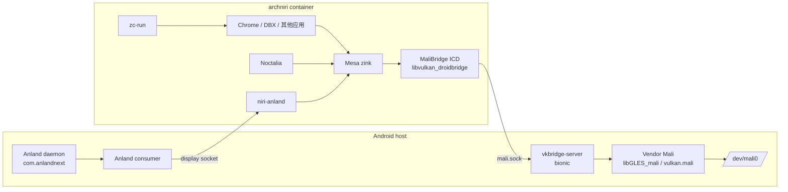

# 架构与组件清单

本文说明 XRING-O3 Mali 方案的分层、每个组件当前所在位置，以及它如何被打包和发布。阅读对象是实现者和复刻者。

## 1. 设备与边界

| 项目 | 值 |
| --- | --- |
| 设备 | Xiaomi Pad 9 Pro Max，型号 `M367FC`，product `yingtian`，board `xring_o3_asic` |
| Android | 17（SDK 37） |
| SoC / GPU | XRING-O3 / Mali-G2-Ultra-NX MC16 |
| 内核 GPU 接口 | Mali kbase（`/dev/mali0`，字符设备 `10,307`） |
| DRM | 只有 `/dev/dri/card0`（`226:0`），没有 `renderD*` |
| 容器 | Droidspaces 7.1.0，容器名 `archniri`，systemd init |

主机侧与容器侧的分界：

- **Android host**：bionic 进程、`/dev/mali0`、vendor Mali、Anland daemon/consumer、Droidspaces daemon。
- **Container**：glibc Arch、Mesa、MaliBridge 客户端 ICD、niri/Noctalia、应用。

## 2. 数据路径

- 显示：Anland 的 socket 由 Droidspaces 绑定到容器 `/run/display.sock`。
- GPU：容器内的 `libvulkan_droidbridge.so` 通过 `/opt/mb-sock/mali.sock` 连接主机 `vkbridge-server`，由后者调用 vendor Mali。
- 预算与运维：`control.sock` 由 `mbctl` / `mb-tray` 使用；`budget.conf` 由 server 读取。

## 3. 主机侧组件

| 组件 | 当前路径 | 说明 | 发布方式 |
| --- | --- | --- | --- |
| Droidspaces | `/data/local/Droidspaces/bin/droidspaces` | v7.1.0，APK 安装；不在 PATH | 上游 APK |
| 容器配置 | `/data/local/tmp/archniri-5x.config` | `enable_anland=1`、`enable_gpu_mode=1`、绑定 `/dev/dma_heap` 与 `/data/local/tmp/vtest` | 文档/模板 |
| Anland daemon | `com.anlandnext` | 显示 producer，socket 在 `/data/local/Droidspaces/Net/anland-<hash>.sock` | 上游 APK |
| Anland consumer | `com.anland.consumer` | 显示 consumer，负责 Android 表面 | 上游 APK |
| `vkbridge-server` | `/data/local/tmp/xring-o3-host/mbsrv/vkbridge-server` | bionic，AArch64，约 13.5 MB；旧路径 `/data/local/tmp/mbsrv/` 仍保留 | `mali-host` 包 |
| supervisor | `/data/local/tmp/xring-o3-host/bridge-supervisor.sh` | server 的父进程，负责 socket 与 `oom_score_adj` | `mali-host` 包 |
| 启动/停止 | `start-bridge.sh`、`stop-bridge.sh` | 手动启动，不写开机启动 | `mali-host` 包 |
| Anland 别名 | `/data/local/tmp/archniri-display.sock` | 指向真实 `Net/anland-<hash>.sock` 的稳定链接 | `mali-host` 包 |
| card0 | `/dev/dri/card0` | 主机节点 `226:0`；容器内由 `xring-o3-card0.service` 再建 | 主机/镜像 |
| 验证 | `verify-host.sh` | 只读检查 server、socket、预算、Anland 链接、vendor 库 | `mali-host` 包 |

`vkbridge-server` 的 SHA-256：`729aa213798b29478cc12d475fc5b6eb5a2c9507c4cde6b5a7e075cc73bf480d`。

`xring-o3-mali-host-2026.11.08.tar.zst`：3,690,365 B，SHA-256 `3def93c0b01bdf5437e9094219a00e62e1495c0da39db93ff84ac5fae31fe179`，包含 `bin/vkbridge-server`、6 个脚本、`host.env.example`、`manifest.env`、`SHA256SUMS`。

## 4. 容器侧组件

### 4.1 Mali stack v2

`xring-o3-mali-stack-2026.11.08-v2.tar.zst`：10,221,520 B，SHA-256 `159ddd879241df78baa2f476e38ac1756e1a9b44c778bd0b8b7c18e50389c08d`，23 个文件，13 个 ELF 均为 AArch64。

| 组 | 文件 | 用途 |
| --- | --- | --- |
| Mesa dt-retire | `mesa/candidate/usr/lib/{libEGL_mesa.so.0,libgallium-26.3.0-devel.so,dri/zink_dri.so}` | Noctalia 链路 |
| Mesa kopper-retire | `mesa/kopper/usr/lib/...` | niri / Chrome / DBX 链路 |
| MaliBridge hook2 | `vkbridge/libvulkan_droidbridge.so`、`share/vulkan/icd.d/droidbridge_icd.json` | Noctalia 链路 |
| MaliBridge format | `vkbridge/format/libvulkan_droidbridge.so`、`share/vulkan/icd.d/droidbridge-format.json` | niri / Chrome / DBX 链路 |
| wl-gone shim | `vkbridge/shim/libvkb_wl_gone.so` | Noctalia 的 wl_surface 生命周期补偿 |
| libgbm 垫片 | `lib/libgbm.so.1` | Chromium/WebKit 的 GBM 探测 |
| libdrmfake | `lib/libdrmfake.so` | WebKit `card0` 探测 |
| zc-run | `bin/zc-run`、`bin/zc-sync`、`lib/zc-run/zc-classify` | 按工具包注入 GPU 环境 |
| mbctl | `bin/mbctl` | 预算 status/set |
| mb-tray | `bin/mb-tray`、desktop、icon | 托盘 |
| 预算模板 | `etc/budget.conf` | 4096 / 2048 / 2048 / 60000 |
| Noctalia 模板 | `share/xring-o3/noctalia-dt` | 安装时生成 `/usr/local/bin/noctalia-dt` |

安装目标：`/opt/mali-stack/<version>`，`current` 为原子符号链接；`/usr/local/bin/{zc-run,zc-sync,mbctl,mb-tray}` 指向 `current/bin`。

### 4.2 设备脚本

| 脚本 | 作用 |
| --- | --- |
| `profile.sh` | 写 `/etc/xring-o3/device-profile`、环境变量、`/opt/mali-stack` 目录；安装 `wait-for-mali-bridge` 链接 |
| `card0.sh` | 安装 `xring-o3-card0.service`，容器启动时 `mknod /dev/dri/card0` |
| `anland.sh` | 安装 `/run/display.sock` 检查单元 |
| `install-mali-stack.sh` | 校验并安装 `mali-stack`，生成 `conf/zc-env.conf`、`conf/noctalia-env.conf`、`noctalia-dt` |
| `verify-mali-stack.sh` | 校验 bundle 布局、SHA256SUMS、AArch64 ELF、ICD 相对路径 |
| `wait-for-bridge.sh` | `desktop-session.service` 的 `ExecStartPre`，等待 `mali.sock` + `control.sock` |
| `session-gpu-env.sh` | niri 会话级 kopper + format 环境 |
| `noctalia-dt.template` | Noctalia 的 dt-retire + hook2 + shim 包装器模板 |

这些脚本的源码在本仓库 `rootfs/device/xring-o3/`。rootfs builder 在镜像构建时按固定 commit 拉取本仓库，并复制到 `/usr/local/lib/droidspaces/device/xring-o3/`。

### 4.3 niri 与 Noctalia

| 项目 | 值 |
| --- | --- |
| niri 版本 | 26.04，commit `8ed0da44d974c32c6877d2f4630c314da0717ecb` |
| Smithay | 0.7.0，commit `ff5fa7df392cecfba049ffed55cdaa4e98a8e7ef` |
| Anland 后端 | `producers/niri/anland_backend/`，来自 Anland 上游 |
| Touch 补丁 | `patches/anland/0001-touch-seat.patch` |
| AFBC 补丁 | `patches/smithay/0001-afbc-linear-size-check.patch` |
| Noctalia | 原生 C++/OpenGL ES/Luau，通过 `noctalia-dt` 启动 |

niri 的构建方式是把官方源码、`niri.patch` 和 Anland 后端 overlay 一起编译；Smithay 用官方源码加 `smithay.patch`。没有 niri 或 Smithay 的长期源码 fork。

## 5. 构建与发布

| 仓库/分支 | 作用 | 当前状态 |
| --- | --- | --- |
| `collegeming/Droidspaces-Arch-Niri-rootfs-builder` `xring-o3-mali` | rootfs 镜像构建：设备脚本按固定 commit 拉取、Mali 栈、偏好阶段 | 已推送，HEAD `95fe284` |
| `collegeming/mesa-cross` | 历史 Mesa/MaliBridge CI；构建 workflow 已迁到本仓库 `.github/workflows/build-mesa.yml`、`build-malibridge.yml` | 只读保留，待新 workflow 验证后停用 |
| `Goldzxcbug/droidspaces-package` | Anland/niri 预编译包的上游 CI 与 Release | 上游参考 |
| 本仓库 `anland-niri-packages` | 带 Touch + AFBC 的 niri 包、xorg-xwayland、manifest | 已发布 |
| `Goldzxcbug/anland` | Anland 上游的 fork，当前多 2 个 HUD 提交 | 上游打包源 |
| `SuperTurtleDev/anland` | Anland 上游主体 | 基线 |
| `ASEbrahim/MaliBridge` | MaliBridge 上游；AFBC 修复在 PR #71 | 上游 |
| 本仓库 | 设备补丁、主机侧脚本、打包工具、文档 | 已创建 |

镜像构建阶段按 `XRING_O3_KIT_REF` 拉取本仓库；离线或 GitHub 不可达时，需要把 `XRING_O3_KIT_REPO` 指到可达镜像。当前 builder 提交 `95fe284` 对应 kit 快照 `c71d58e`。

### 5.1 可复现性核对

`build-mesa.yml` 与 `build-malibridge.yml` 的 artifacts 与已发布 stack v2 的对应文件逐个 SHA256 一致：

| 文件 | SHA-256 |
| --- | --- |
| Mesa dt `libEGL_mesa.so.0` | `b78067eb84452b23fb63b96360e22db41fda65b7eb11bbad1a8a254aff4c9bd1` |
| Mesa dt `libgallium-26.3.0-devel.so` | `cbc8165ebfee355f7f5d835e2fe8c5c49b7b025a06f5973591147d0b843f1b48` |
| Mesa dt `dri/zink_dri.so` | `89aab1520fab91f1ebb8b42b5939db8f942027cfec20a21b3c8c396fe16a959a` |
| Mesa kopper `libgallium-26.3.0-devel.so` | `0d4976c165235774f0fc9a4f532cb662b9149e3729933fb12d57fc4c9071d604` |
| MaliBridge hook2 client | `afb10215b1a2e7fcac7f9560b9eb6e5acc3ea31e4d07a7045bec82218d137b37` |
| MaliBridge format client | `f7b19ff880aa7e8fb2fe2bedc8d788745be345cdeaaaa276722ebc947fbc6dc4` |
| wl-gone shim | `c2cc0a08c770adefb15c1e2c0f2dab51c624acb74b93d8d17895eea14ca49676` |

这组核对证明 stack v2 的 Mesa 与 MaliBridge 二进制可以由本仓库 CI 从固定源码和补丁重建，不依赖设备 `/opt` 的实验副本。

## 6. 版本与校验

| 对象 | 版本/校验 |
| --- | --- |
| rootfs builder | `xring-o3-mali` @ `95fe284` |
| Mali stack v2 | `159ddd879241df78baa2f476e38ac1756e1a9b44c778bd0b8b7c18e50389c08d` |
| Mali host | `3def93c0b01bdf5437e9094219a00e62e1495c0da39db93ff84ac5fae31fe179` |
| vkbridge-server | `729aa213798b29478cc12d475fc5b6eb5a2c9507c4cde6b5a7e075cc73bf480d` |
| Mesa dt-retire | run 42369276110，26.3.0-devel，rev 98f3d62 |
| Mesa kopper-retire | run 42194036783 |
| MaliBridge hook2 | run 42378271764 |
| MaliBridge format | run 42268762436 |

## 7. 未发布与未验证

- `mali-stack` 与 `mali-host` 尚未上传到 GitHub Release。
- 带 Touch/AFBC 的 `niri-anland` 包尚未构建。
- Mali 时代的 rootfs 镜像尚未发布。
- 当前设备的 `/opt` 是实验室状态：`/opt/mesa-dt-retire-*`、`/opt/mb-*` 等候选目录与安装器目标 `/opt/mali-stack/current` 并存；镜像以安装器布局为准。
